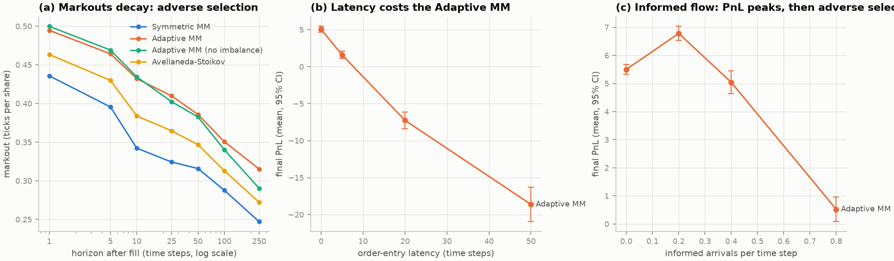
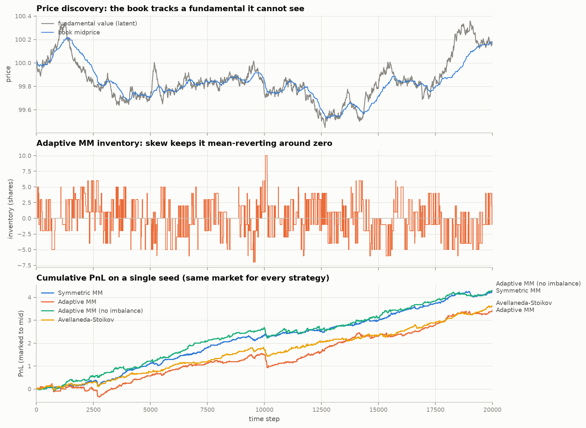
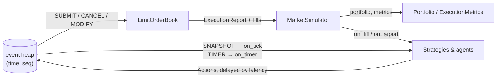

# Market Microstructure Simulator

[](https://github.com/Space-Paragon1/Market-Microstructure-Simulator/actions/workflows/ci.yml)


A **price-time priority matching engine** and an **event-driven market simulator**
for studying liquidity provision, execution quality and adverse selection, in pure
Python with no runtime dependencies.

- **Matching engine.** Integer tick grid, O(1) cancel, `GTC`/`IOC`/`FOK`, market and
  post-only orders, self-trade prevention, exchange-style modify semantics and
  FIX-like execution reports. Its correctness is checked against an independent
  reference model with property-based testing.
- **Closed-loop market.** Zero-intelligence noise traders and informed traders
  around a latent fundamental value, so prices are *discovered* and liquidity
  providers face real adverse selection.
- **Research layer.** Order-entry latency, strategy timers and callbacks; four market
  makers including Avellaneda–Stoikov; markouts, slippage vs arrival, spread
  capture, PnL and inventory analytics; deterministic, seed-controlled experiments.

---

## Results

`examples/compare_market_makers.py` runs every strategy in the same market over
16 seeds × 20,000 time steps. For a given seed, every strategy faces the identical
fundamental path and exogenous order arrivals (common random numbers). The 192
simulations take about 26 s on a laptop.



**1. Strategy comparison** (latency 0; `t` = ticks per share)

| Strategy | PnL | s.e. | Sharpe | Mean \|inv\| | Spread capture | Markout @1 | Markout @100 |
|---|---:|---:|---:|---:|---:|---:|---:|
| Symmetric MM | 4.43 | 0.16 | 6.47 | 1.88 | 0.56 t | 0.44 t | 0.29 t |
| **Adaptive MM** | **5.04** | 0.21 | **6.89** | 1.97 | 0.59 t | 0.49 t | 0.35 t |
| Adaptive MM, no imbalance lean | 4.46 | 0.22 | 5.97 | 1.98 | 0.61 t | 0.50 t | 0.34 t |
| Avellaneda–Stoikov (rolling τ) | 4.53 | 0.17 | 6.38 | 1.81 | 0.58 t | 0.46 t | 0.31 t |

**2. Latency** (Adaptive MM)

| Latency (steps) | 0 | 5 | 20 | 50 |
|---|---:|---:|---:|---:|
| PnL | 5.04 ± 0.21 | 1.59 ± 0.26 | −7.27 ± 0.59 | −18.63 ± 1.19 |
| Markout @100 | 0.35 t | 0.33 t | 0.18 t | −0.26 t |

**3. Informed flow** (Adaptive MM)

| Informed arrivals / step | 0.0 | 0.2 | 0.4 | 0.8 |
|---|---:|---:|---:|---:|
| PnL | 5.50 ± 0.09 | 6.78 ± 0.13 | 5.04 ± 0.21 | 0.52 ± 0.22 |
| Sharpe | 16.3 | 12.4 | 6.9 | 0.5 |
| Markout @100 | 0.48 t | 0.41 t | 0.35 t | 0.16 t |

What the experiments show:

- **Markouts decay with horizon for every maker.** Part of the spread earned at
  the fill is given back as the price moves against it. That is adverse
  selection, measured directly.
- **The order-book-imbalance signal is worth about +0.6 PnL** (5.04 vs 4.46). It is
  the only difference between those two runs.
- **Latency is ruinous for a liquidity provider.** Slow quotes become stale. At
  50 steps the 100-step markout turns negative: the maker is systematically picked
  off.
- **Informed flow cuts both ways.** It brings volume, so PnL first rises, but
  Sharpe and markouts fall monotonically, and at high intensity adverse selection
  overwhelms the spread.
- Avellaneda–Stoikov needs γ calibrated to the *realized* mid volatility, which
  is about 3.6× lower than the fundamental's, because the book lags and smooths
  the latent value. With a γ chosen against the fundamental, its inventory skew
  is negligible and it carries inventory through trends.



*Single seed. The book tracks the latent fundamental with a lag; the Adaptive MM's
inventory mean-reverts around zero. Rankings on one seed differ from the 16-seed
averages above.*

---

## Matching engine

```python
from microbook import LimitOrderBook, Order, Side, STPMode, TimeInForce

lob = LimitOrderBook(tick_size=0.01, stp=STPMode.CANCEL_RESTING)
lob.submit(Order.limit("a1", Side.SELL, 100.02, 5, owner="mm"))
lob.submit(Order.limit("a2", Side.SELL, 100.03, 10))

r = lob.submit(Order.limit("b1", Side.BUY, 100.03, 20))  # sweeps 2 levels, rests 5
print(r.status, [(f.price, f.qty) for f in r.fills], r.resting_qty)
# OrderStatus.PARTIALLY_FILLED [(100.02, 5), (100.03, 10)] 5

r = lob.submit(Order.limit("b2", Side.SELL, 100.03, 8, tif=TimeInForce.IOC))
print(r.status, r.filled_qty, r.canceled_qty)  # CANCELED 5 3

r = lob.modify("b1", new_qty=0)  # cancel via modify
print(lob.depth(), lob.check_invariants())
```

`examples/quickstart.py` tours every feature.

| Message | Semantics |
|---|---|
| `LIMIT` `GTC` | match while crossing, rest the remainder |
| `LIMIT` `IOC` | match while crossing, cancel the remainder |
| `LIMIT` `FOK` | fill completely or do nothing (pre-checked, no side effects) |
| `MARKET` | sweep the opposite side, never rests |
| `post_only` | rejected if it would take liquidity |
| `modify` reduce | same price, smaller size: amended in place, **keeps priority** |
| `modify` reprice / increase | loses priority (cancel/replace); a crossing reprice trades and returns its fills |
| self-trade | `NONE`, `CANCEL_RESTING` or `CANCEL_INCOMING`, keyed on `Order.owner` |
| invalid input | duplicate id, off-tick price, bad modify → `REJECTED`, book untouched |

**Data structures.** Prices are stored as integer ticks, so float keys can never
alias and off-grid prices are rejected. Each side keeps a sorted list of price
keys with the best price at the *end*, so reading or removing the touch is O(1).
Each level is an `OrderedDict` (FIFO, O(1) removal by id) with an incrementally
maintained aggregate size.

**Correctness.** `tests/test_book_model.py` drives random sequences of submits,
cancels, modifies and duplicate submits through the engine and through a
deliberately naive reference book (a flat list re-sorted on every message), under
all three STP modes. After every step the two must agree exactly on fills,
statuses and depth, and `check_invariants()` must pass. Injecting a FIFO
violation, an off-by-one in the crossing test, or a stale level-size cache each
makes the test fail.

**Performance** (`benchmarks/bench_book.py`: 200k messages, 55% passive adds, 35%
cancels, 10% aggressive; Apple M2, CPython 3.12):

| | v0.1 | v0.2 |
|---|---:|---:|
| Throughput | 139k msg/s | **484k msg/s** |
| Cancel p50 / p99 | 13.8 µs / 44.4 µs | **0.50 µs / 1.08 µs** |
| Aggressive p50 | 2.00 µs | 1.96 µs |
| Passive add p50 | 0.54 µs | 0.88 µs |

Passive adds are slower because they now pay for duplicate-id protection, tick
validation and an execution report. Cancels dominate real message traffic, so
throughput still improves 3.5×. The full simulator, including agents and
analytics, runs at about 160k events/s (`benchmarks/bench_sim.py`).

---

## Simulator



- **Deterministic.** Events are ordered by `(time, seq)`, ties resolve FIFO, and
  every random stream is seeded per agent. The test suite asserts bit-identical
  reruns.
- **Strategies never touch the book.** They read it and return `Action`s; order
  messages arrive after the strategy's `latency`, while decisions use the
  then-current book. Arrival mid is recorded at *decision* time, so implementation
  shortfall includes latency.
- **Accounting.** Fills are attributed to the maker and the taker. `Portfolio`
  uses average cost with maker/taker fees. Every participant is an agent, so total
  PnL is exactly zero-sum, and that is tested.

**Market agents** (`microbook.sim.agents`, assembled by `build_market`):

| Agent | Behaviour |
|---|---|
| `FundamentalValue` | latent Gaussian random walk (optional jumps); invisible to the book |
| `NoiseTrader` | zero-intelligence population (Smith, Farmer et al., 2003): Poisson limit orders placed relative to the opposite touch, Poisson market orders, proportional random cancellation |
| `InformedTrader` | IOC orders when the book is mispriced vs the fundamental by more than a threshold |

**Strategies:**

| Strategy | Idea |
|---|---|
| `MarketMaker` | symmetric quotes around mid, fixed inventory skew |
| `AdaptiveMarketMaker` | volatility-scaled spread, inventory skew, order-book-imbalance lean, hard limits |
| `AvellanedaStoikovMarketMaker` | reservation price `s − qγσ²τ` and optimal spread `γσ²τ + (2/γ)ln(1+γ/k)`, finite or rolling horizon, online σ |
| `TWAPExecutor` | time-sliced market orders; unfilled remainder rescheduled |

Market makers derive from `TwoSidedQuoter`, which rounds passively onto the grid,
never quotes through the opposite touch (post-only), and leaves unchanged quotes
alone so they keep queue priority.

### Writing a strategy

```python
from microbook import Order, Side
from microbook.sim import Action, MarketConfig, Strategy, build_market, strategy_report


class WideSpreadBuyer(Strategy):
    """Buys 5 shares whenever the spread widens to 3+ ticks; checks every 50 steps."""

    def on_start(self, now, lob):
        return [Action.timer(now + 50)]

    def on_timer(self, now, lob):
        actions = [Action.timer(now + 50)]
        spread = lob.spread()
        if spread is not None and spread >= 3 * lob.tick_size:
            actions.append(Action.submit(Order.market(self.next_order_id(), Side.BUY, 5), now))
        return actions


market = build_market(MarketConfig(seed=1), [WideSpreadBuyer("wsb", latency=2)], horizon=10_000)
sim = market.run(10_000)
print(strategy_report(sim, ["wsb"])["wsb"])
```

Hooks: `on_start`, `on_tick` (every `SNAPSHOT`), `on_timer`, `on_fill(now, fill, side, is_maker, lob)`
and `on_report(now, report)`. Each returns a list of `Action`s.

### Metrics

| Metric | Definition |
|---|---|
| Slippage vs arrival | fill VWAP − mid at decision time (buys; mirrored for sells), over orders with a known arrival mid |
| Spread capture | maker fills: distance from the **pre-trade** mid, per share |
| Markout @h | `side × (mid(t+h) − fill price)`, volume-weighted; its decay with *h* measures adverse selection |
| Fill ratio / participation | filled ÷ submitted; own volume ÷ market volume |
| PnL stats | final, max drawdown, per-sample PnL volatility, Sharpe (mean/std of increments × √n, not annualised) |

---

## Project layout

```
src/microbook/
├── book.py               # LimitOrderBook: matching engine
├── order.py, types.py    # Order, Side, Fill, ExecutionReport, enums
└── sim/
    ├── simulator.py      # MarketSimulator: event loop, latency, attribution
    ├── strategy.py       # Strategy, Action, TwoSidedQuoter, MarketMaker, TWAPExecutor
    ├── strategies_mm.py  # AdaptiveMarketMaker, AvellanedaStoikovMarketMaker
    ├── agents.py         # FundamentalValue, NoiseTrader, InformedTrader
    ├── scenarios.py      # MarketConfig, build_market
    ├── portfolio.py      # average-cost PnL with maker/taker fees
    ├── execution_metrics.py, analytics.py, metrics.py
    └── orderflow.py      # open-loop Poisson flow (controlled tests)
examples/                 # quickstart, static_flow, compare_market_makers
benchmarks/               # bench_book, bench_sim, profile_book
tests/                    # 121 tests incl. model-based and property-based
```

## Development

```bash
python -m venv .venv && source .venv/bin/activate
pip install -e ".[dev]"

pytest --cov                                     # tests + coverage (94% branch)
ruff check . && ruff format --check .            # lint / format
mypy                                             # strict type checking

python examples/compare_market_makers.py --plot docs/figures   # regenerate results
python benchmarks/bench_book.py                                # engine benchmark
```

## Limitations

- Single instrument, discrete integer clock, and no hidden or iceberg orders. Fees
  are per share.
- The agents are stylized and their parameters are chosen for plausible depth,
  spread and tracking. They are **not** fitted to market data, so treat the results
  as qualitative mechanisms rather than calibrated estimates.
- Pure Python: fast enough for research loops (hundreds of thousands of messages
  per second), not a production matching engine.

## License

MIT. For education and research; it does not connect to any market.
